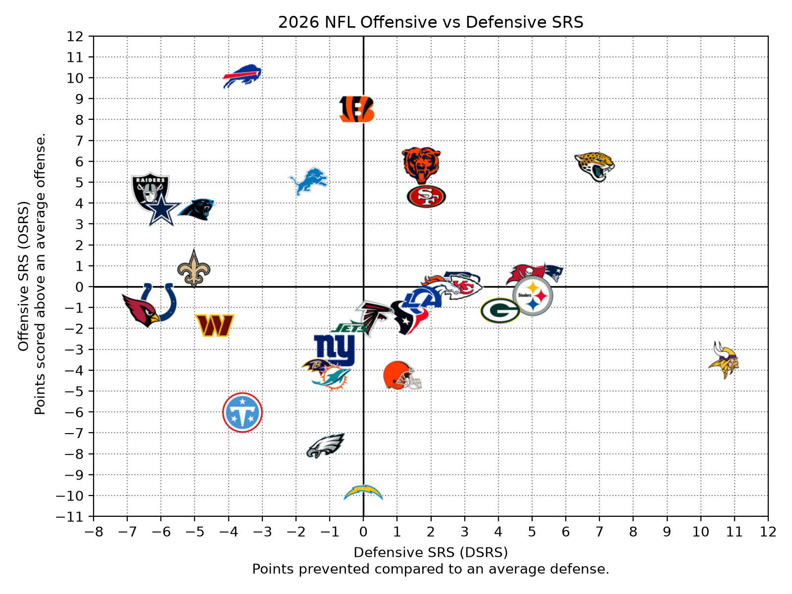

# NFL SRS Model

A Bayesian take on the Simple Rating System (SRS) for forecasting NFL games and
seasons. Team ratings start from a prior based on preseason win-total
over/unders and are updated with this season's results as games are played.
The updated ratings are used to predict game margins and win probabilities and
to simulate the rest of the regular season for playoff, division, and top seed
odds.

Full dashboard of results published [here](https://nfl-srs-forecast.lovable.app/).



## How it works

1. **Observed SRS.** Offensive and defensive ratings are fit by least squares
   on every game played so far. Each team's points in a game are modeled as:

   ```
   points = league avg + own offense - opponent defense ± HFA/2
   ```

   A team's total SRS is `osrs + dsrs`: how many points better than an
   average team it is on a neutral field. The fit also estimates home field
   advantage (HFA) and `sigma_obs`, the standard deviation of actual margins
   around predicted ones.

2. **Prior SRS.** Each team's preseason win-total over/under is centered on
   the league average and converted to SRS points with `SLOPE`. The prior's
   uncertainty is `TAU`. Both constants were estimated from past seasons in
   `data/raw/srs_prior_calc.xlsx`.

3. **Posterior SRS.** The prior and observed ratings are blended with a
   normal-normal Bayesian update, with each weighted by its precision. Early in
   the season ratings stay close to the prior. As a team plays more games, its
   observed results take over.

4. **Game predictions.** The expected home margin is
   `srs_home - srs_away + HFA` (HFA is left out at neutral sites). HFA is also
   a blend of this season's observed value and the prior season's. Margins are
   treated as normally distributed, which gives a home win probability:
   `P(home win) = P(margin > 0)`.

   The std dev of the margin adds the game-to-game noise to the uncertainty in
   each team's rating (variances add):

   | View | Margin std dev |
   | --- | --- |
   | `prior` | `sqrt(13.5² + 2·TAU²)`: historical game noise plus prior uncertainty for both teams |
   | `obs` | `sqrt(sigma_obs² + sigma_obs²/n_home + sigma_obs²/n_away)`: game noise plus the standard error of each team's observed rating |
   | `post` | `sqrt(sigma_obs² + σ²_home,post + σ²_away,post)`: game noise plus each team's posterior rating uncertainty |

   A team's posterior std dev is `1 / sqrt(n/sigma_obs² + 1/TAU²)`. It starts
   at `TAU` and shrinks toward 0 as the team plays more games, so the `post`
   margin std dev narrows toward `sigma_obs` over the season.

5. **Season simulation.** Every remaining game is simulated `N_SIMS` times
   using those win probabilities. Each simulated season is seeded with the
   NFL's playoff format (4 division winners and 3 wildcards per conference).
   The results are then averaged into playoff, division, and top seed odds.

Each prediction can be made from three **views**: `prior` (preseason only),
`obs` (this season's results only), or `post` (the Bayesian blend, the
default).

## Project structure

```
data/
  raw/           Preseason over/unders and the prior calculation workbook
  schedule/      Full schedule, split into past/future games, plus team records
  srs/           Weekly SRS and HFA history, and the latest team SRS table
  predictions/   Current predictions (dated copies are saved in archive/)
  assets/        Generated charts
  cache/         Cached team logos
src/
  config.py          Season, model constants, divisions, and file paths
  load_schedule.py   Pulls the schedule and results, writes past/future/records
  srs_model.py       Fits observed SRS and adds prior and posterior SRS
  predict_probs.py   Predicts margins and win probabilities for remaining games
  simulate.py        Monte Carlo simulation of the rest of the regular season
  srs_scatter.py     Plots offensive vs defensive SRS with team logos
  last_updated.py    Records when the model was last run and the latest completed week
  run_sims.sh        Runs the full weekly pipeline in order
```

## Setup

Requires Python 3.12+.

```bash
pip install pandas numpy nflreadpy matplotlib pillow requests
```

Schedule, results, and team logos come from
[nflreadpy](https://github.com/nflverse/nflreadpy).

## Usage

Data paths in `config.py` are relative (`../data/`), so run the scripts from
inside `src/`. To run the whole weekly pipeline at once:

```bash
cd src
bash run_sims.sh
```

`run_sims.sh` uses the virtual environment at `../.venv/` (edit `PY` at the
top of the script if yours lives elsewhere) and stops at the first script that
fails. To run the steps by hand, in order:

```bash
cd src
python load_schedule.py   # update the schedule and results
python srs_model.py       # refit ratings
python srs_scatter.py     # regenerate the OSRS vs DSRS chart
python predict_probs.py   # predict upcoming games and print next week's picks
python simulate.py        # simulate the season and print playoff odds
python last_updated.py    # record the run time and latest completed week
```

### Outputs

| File | Written by | Contents |
| --- | --- | --- |
| `data/schedule/{schedule,past,future,records}.csv` | `load_schedule.py` | Schedule, completed and remaining games, team records |
| `data/srs/{season}_weekly_srs.csv`, `{season}_weekly_hfa.csv` | `srs_model.py` | Week-by-week ratings and HFA |
| `data/srs/team_srs_data.csv` | `srs_model.py` | Prior, observed, and posterior SRS for each team |
| `data/predictions/predicted_margins.csv` | `predict_probs.py` | Margins, margin std devs, and win probabilities for all remaining games (dated copies in `archive/`) |
| `data/predictions/week{N}_prediction_{view}.csv` | `predict_probs.py` | Picks for the upcoming week |
| `data/predictions/reg_season_predictions_{view}.csv` | `simulate.py` | Average wins and playoff, division, and top seed odds |
| `data/last_updated.csv` | `last_updated.py` | Time of the last run and the latest completed week |

## Configuration

Key settings in `src/config.py`:

| Setting | Meaning |
| --- | --- |
| `CURRENT_SEASON` | Season to model |
| `TAU` | Std dev of true SRS around the preseason prior |
| `SLOPE` | SRS points per win of preseason over/under |
| `PRIOR_HFA` | Home field advantage from the prior season |
| `N_SIMS` | Number of season simulations |

To start a new season, update `CURRENT_SEASON`, add that season's over/unders
to `data/raw/`, update `PRESEASON_OVERUNDERS`, and re-estimate the prior
constants.

## Limitations

- Ties in the standings and playoff seeding are broken by SRS rather than the
  NFL's full tiebreaker rules (head-to-head, division record, etc.).
- `sigma_obs` is estimated in-sample (on the same games used to fit the
  ratings), with a degrees-of-freedom correction.
- Ratings in the season simulation are fixed and don't update as simulated
  games are played.
- The `prior` view's game noise (13.5) is hard-coded in `predict_probs.py`
  rather than set in `config.py`.
- Uncertainty in HFA is not included in the margin std dev.
